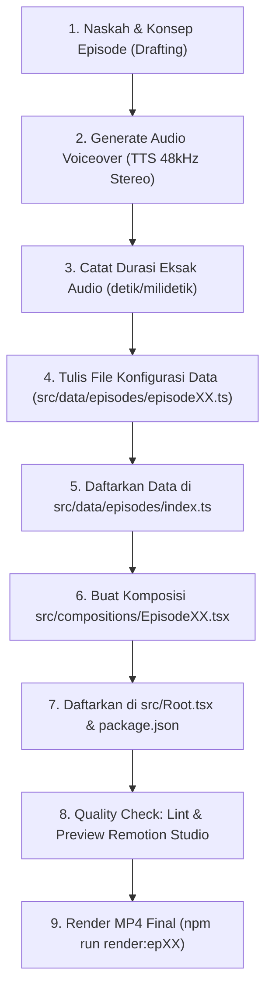

# Panduan Produksi Episode Baru
## Series: SATU HARI SATU FAKTA KERJA DI BAGIAN IT SUPPORT

Sistem produksi video animasi 3D edukatif Instagram Reels (`1080x1920`, `9:16`, `30 FPS`) berbasis **Remotion + Three.js (`@remotion/three`) + GSAP**.

Dokumentasi ini adalah Standar Operasional Prosedur (SOP) resmi untuk memproduksi episode baru secara cepat, konsisten, dan berkualitas tinggi.

---

## 1. Alur Kerja (Workflow) Produksi Episode Baru

Apakah membuat file konfigurasi data `src/data/episodes/episodeXX.ts` dulu, atau audio dulu?

Jawabannya adalah **Alur Naskah-First yang Tersinkronisasi**:



### Mengapa Urutan Ini Paling Tepat?
1. **`episodeXX.ts` adalah Single Source of Truth (SSOT)**: Mengatur semua elemen visual, pergerakan kamera, properti 3D, gestur karakter, sound effect, dan subtitle per-kata.
2. **Durasi Remotion Bergantung pada Audio**: Remotion bekerja dengan frame eksak (`30 FPS`). Jika kita mengarang durasi sebelum audio ada, subtitle dan animasi akan meleset dari suara aslinya. Oleh karena itu, kita tentukan naskah narasi -> generate file suara -> dapatkan durasi eksak -> barulah susun `episodeXX.ts` secara presisi sampai milidetik!

---

## 2. Rincian Langkah Demi Langkah (Step-by-Step SOP)

### Langkah 1: Tentukan Topik & Naskah Narasi (6 Scene Standar)
Setiap episode dirancang memiliki **6 scene naratif** dengan target durasi total **60 - 75 detik** (atau hingga 90 detik):
1. **Scene 1 (Hook)**: Wajib diawali kalimat keramat:
   > *"Satu hari, satu fakta kerja di bagian IT Support! ..."*
   Menampilkan masalah/keluhan user kantor yang umum dan bikin penasaran.
2. **Scene 2 (Fakta 1 - Bukti Teknis / Sistem)**:
   IT Support mengecek log/sistem (Task Manager, log server, firewall, dsb). Menyertakan `FactInfoHUD` status card.
3. **Scene 3 (Fakta 2 - Akar Masalah / Fitur Tersembunyi)**:
   Menjelaskan aspek teknis mendalam dengan bahasa santai yang mudah dipahami orang awam.
4. **Scene 4 (Fakta 3 - Solusi / Alasan di Balik Tindakan IT)**:
   Mengapa tindakan tertentu (seperti restart, ganti kabel, cek phishing) menyelesaikan 90% masalah.
5. **Scene 5 (Plot Twist - Realita Lapangan)**:
   Kejadian lucu/konyol yang sering dihadapi IT Support di meja user kantor. Menampilkan `twistCallouts`.
6. **Scene 6 (Closing - Checklist & CTA)**:
   Rangkuman praktis cara pencegahan bagi user + Call To Action follow akun **ERROR TERUS (`@error_terusya`)**.
   *(Catatan: Outro resmi `ErrorTerusOutroScene` 4.2 detik otomatis ditambahkan di akhir oleh `EpisodeTemplate`).*

---

### Langkah 2: Generate Audio Voiceover (TTS)
1. Buat direktori `public/audio/epXX/`.
2. Generate suara narasi Bahasa Indonesia untuk masing-masing scene (`scene1.wav` sampai `scene6.wav`) menggunakan TTS studio (`aistudio-tts` atau voiceover resmi).
3. Pastikan format audio: **WAV 48.000 Hz, Stereo 16-bit PCM** (resample dengan FFmpeg jika perlu).
4. Catat durasi eksak masing-masing audio dalam detik (misal `13.56s`, `15.76s`, dll.).

---

### Langkah 3: Susun File Konfigurasi Data (`src/data/episodes/episodeXX.ts`)
Salin template dari episode sebelumnya (misal `episode03.ts`) menjadi `src/data/episodes/episodeXX.ts`.
Isi seluruh properti secara lengkap:
- `id`: `"EpisodeXX"`
- `episodeNumber`: `"XX"`
- `title`: Judul huruf kapital yang menarik.
- `topic`: Nama topik singkat.
- `scenes`: Array dari 6 scene, dengan:
  - `durationSec`: **Wajib sama persis dengan durasi file audio scene tersebut**.
  - `subtitles`: Potongan kata tersinkronisasi milidetik dengan highlight warna aksen (`C_BLUE`, `C_YELLOW`, `C_RED`, `C_GREEN`, `C_ORANGE`).
  - `cast`: Karakter yang tampil (`it_support`, `office_worker`, `manager`, `finance_staff`) lengkap dengan posisi, rotasi, dan `cues` animasi per detik.
  - `cameraKeyframes`: Pergerakan kamera 3D per detik dengan easing yang halus.
  - `screenMode`: Tampilan layar monitor workstation (`idle_desktop`, `freezing`, `task_manager`, `chrome_chaos`, `healthy`, dsb).
  - `factCard` / `twistCallouts`: HUD grafis infografis.
  - `sfx`: Efek suara berwaktu presisi (`pop.wav`, `ding.wav`, `vine-boom.wav`, dll.).
- `socialCaption`: Caption otomatis untuk posting di Instagram Reels, Threads, TikTok, YouTube Shorts lengkap dengan hashtag dan call-to-action.

---

### Langkah 4: Daftarkan di Data Index (`src/data/episodes/index.ts`)
1. Import `episodeXX` dan export kembali.
2. Tambahkan `episodeXX` ke array `ALL_EPISODES`:
```ts
export const ALL_EPISODES: EpisodeConfig[] = [episode01, episode02, episode03, episode04];
```

---

### Langkah 5: Buat Komposisi Tipis (`src/compositions/EpisodeXX.tsx`)
Buat file tipis yang menghubungkan data ke template reusable:
```tsx
import React from "react";
import { episode04 } from "../data/episodes";
import { EpisodeTemplate } from "./EpisodeTemplate";

export const Episode04: React.FC = () => {
  return <EpisodeTemplate episode={episode04} />;
};
```
Export di `src/compositions/index.ts`:
```ts
export * from "./Episode04";
```

---

### Langkah 6: Daftarkan di `src/Root.tsx` & `package.json`
1. Di `src/Root.tsx`:
   - Import `EpisodeXX` dan `episodeXX`.
   - Hitung total frames: `const EPXX_TOTAL_FRAMES = getEpisodeTotalFrames(episodeXX, VIDEO_SPECS.fps);`
   - Tambahkan `<Composition id="EpisodeXX" ... />` di dalam `<RemotionRoot>`.
2. Di `package.json`:
   - Tambahkan script render:
     `"render:epXX": "remotion render EpisodeXX out/SATU-HARI-SATU-FAKTA-IT-SUPPORT-EPXX.mp4 --codec=h264 --audio-codec=aac --gl=angle"`

---

### Langkah 7: Quality Check & Preview
1. Jalankan `npm run lint` untuk memastikan tidak ada kesalahan tipe TypeScript atau ESLint.
2. Jalankan `npm run dev` atau `npm run studio` untuk melihat preview interaktif di Remotion Studio.
   - Periksa apakah subtitle pas dengan ucapan audio.
   - Periksa apakah teks berada di dalam Reels Safe Zone (`subtitleBottom: 380px`).
   - Periksa transisi kamera dan kelancaran animasi karakter.

---

### Langkah 8: Render Final MP4
Jalankan perintah render:
```bash
npm run render:epXX
```
Video MP4 1080x1920 30FPS akan disimpan di `out/SATU-HARI-SATU-FAKTA-IT-SUPPORT-EPXX.mp4`.

---

## 3. Daftar Karakter 3D & 15 Animasi Resmi

Karakter dalam serial ini menggunakan sistem rig deterministik per-frame:

### Role Karakter:
- `it_support`: Karakter teknisi IT utama (hoodie navy, kacamata tech, headset, tas teknisi, laptop).
- `office_worker`: Rekan kerja kantor berkemeja santai yang sering panik/bingung.
- `manager`: Pimpinan tim berjas rapi/blazer yang fokus pada deadline.
- `finance_staff`: Staff keuangan yang sangat sensitif dengan angka & nota.

### 15 Animasi Deterministik:
1. `idle` — Berdiri santai siap bicara.
2. `walking` — Berjalan di area studio/kantor.
3. `running` — Berlari terburu-buru menangani insiden.
4. `sitting` — Duduk di workstation desk.
5. `typing` — Mengetik cepat di keyboard diagnostik.
6. `thinking` — Mengelus dagu menganalisis masalah teknis.
7. `pointing` — Menunjuk ke arah layar atau kartu fakta HUD.
8. `explaining` — Gestur tangan aktif menjelaskan ke kamera.
9. `surprised` — Kaget / terkesiap melihat anomali sistem.
10. `confused` — Garuk kepala bingung menghadapi error aneh.
11. `panicking` — Gestur panik ketika komputer macet total.
12. `troubleshooting` — Mengamati perangkat keras/kabel dengan cermat.
13. `celebrating` — Merayakan keberhasilan saat error terselesaikan.
14. `facepalm` — Menepuk jidat saat mengetahui penyebab sepele user.
15. `looking_at_screen` — Mengamati layar monitor dengan serius.

---

## 4. Safe Zone Instagram Reels (Portrait 9:16)
- **Top Safe Zone**: 180px dari atas (bebas dari overlay UI kamera/pencarian).
- **Bottom Safe Zone**: Minimal 380px dari bawah agar subtitle tidak tertutup username, caption, atau judul lagu.
- **Right Safe Zone**: Margin kanan 135px agar tidak bertabrakan dengan tombol Like, Komentar, Share, dan Audio icon.

---

## 5. Ringkasan Episode yang Sudah & Siap Diproduksi
- **Episode 01**: `KENAPA KOMPUTER KANTOR SERING LEMOT?` (5 scene)
- **Episode 02**: `IT SUPPORT WAJIB KUASAI 3 ELEMEN AVATAR!` (6 scene)
- **Episode 03**: `USER BILANG GAK KLIK APA-APA, TAPI LOG KETAWA!` (6 scene)
- **Episode 04**: `KATANYA UDAH DI-RESTART, KOK UPTIME 47 HARI?!` (6 scene)
- **Episode 05**: `WIFI KANTOR LEMOT? BUKAN SALAH ROUTER DOANG!`
